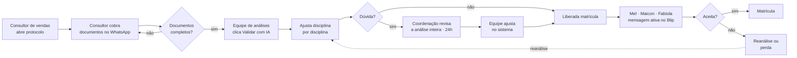
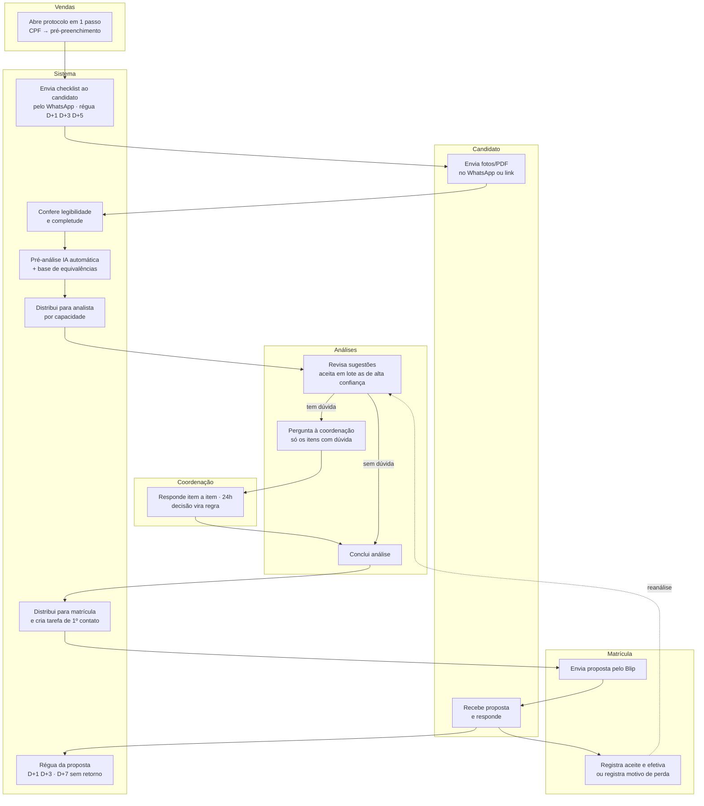

# 02 · Jornada e processo

## 1. Os quatro tipos de solicitação

| Tipo | Quem é | Vínculo | De onde vem o histórico | Particularidade |
|---|---|---|---|---|
| **Transferência externa** | Estuda em outra IES e quer vir para a UniAnchieta | Vínculo ativo com a IES de origem | Documento externo (histórico + planos de ensino) | LDB art. 49: cursos afins e existência de vaga **[VALIDAR com Secretaria/Jurídico]** |
| **Portador de diploma** | Já é graduado e quer outra graduação | Nenhum | Diploma + histórico da graduação | Normalmente alto aproveitamento; regras no regimento interno **[VALIDAR]** |
| **Transferência interna** | Aluno da UniAnchieta que quer trocar de curso | Ativo | Histórico interno (automático) | Equivalência entre matrizes internas: altamente automatizável |
| **Retorno ao curso** | Ex-aluno sem vínculo **ou** aluno com vínculo que passou por alteração curricular | Com ou sem | Histórico interno + eventual histórico externo do período fora | "Mudança de matriz": mapear matriz antiga → nova |

Subtipos de retorno (campo `subtipo`): `SEM_VINCULO`, `COM_VINCULO_ALTERACAO_CURRICULAR`.

## 2. Como é hoje (as-is)

Pontos de esforço do as-is: B (manual, repetitivo), D (gatilho manual), G (revisão integral), I→J
(sem prazo de primeiro contato), M (motivo de perda não padronizado).

## 3. Como passa a ser (to-be)

### Atalhos por tipo (o sistema escolhe sozinho)

- **Transferência interna** e **retorno com vínculo:** não há etapa de documentos externos. O
  histórico interno é migrado automaticamente ("Migrar histórico") e a pré-análise usa o mapeamento
  entre matrizes internas. Meta: a maioria desses casos não passa pela coordenação **[HIPÓTESE]**.
- **Retorno sem vínculo:** pergunta no protocolo "Estudou em outra instituição no período?". Se não,
  segue como interno; se sim, pede histórico externo.
- **Portador de diploma:** checklist com diploma (frente e verso) e histórico.
- **Transferência externa:** checklist com histórico da IES de origem e planos de ensino das
  disciplinas; verificação de vaga no curso/turno de destino **[VALIDAR origem do dado de vagas]**.

## 4. Jornada do candidato (o que ele vive e o que sente)

| Momento | O candidato quer | Risco de atrito | Resposta do sistema |
|---|---|---|---|
| Decide pedir análise | Saber se vale a pena | Esperar dias sem resposta | Protocolo imediato + mensagem com o que acontece a seguir e prazo |
| Envia documentos | Fazer uma vez só, pelo celular | Não saber o que enviar; reenvios | Checklist claro por tipo, envio pelo WhatsApp, aviso imediato de arquivo ilegível |
| Espera a análise | Saber em que pé está | Silêncio | Mensagem "documentos completos, análise em até X" **[parâmetro]** |
| Recebe a proposta | Entender o que aproveita, quanto tempo falta e quanto custa | Juridiquês, números que mudam depois | Resumo simples (disciplinas aproveitadas, CH, previsão de semestres, valores) só após análise concluída |
| Decide | Tirar dúvidas com uma pessoa | Ser transferido de setor | Um responsável da matrícula com nome; botão de resposta rápida |
| Matricula | Começar sem surpresa | Promessa diferente da entrega | O que foi proposto é o que está no sistema (mesma fonte) |
| Primeiras semanas | Se integrar | Evasão precoce (ver Frente 2) | Evento `matricula.efetivada` alimenta a régua de boas-vindas **[fora do escopo, integração futura]** |

## 5. Jornada do colaborador (onde o esforço some)

| Papel | Antes | Depois |
|---|---|---|
| Consultor de vendas | Abre protocolo, cobra documento, pergunta status para a equipe | Abre em 1 minuto, acompanha na mesma tela, é avisado quando há ação dele |
| Equipe de análises | Procura o próximo caso, clica IA, decide 45 linhas, manda tudo à coordenação | "Pegar próximo", sugestões prontas, aceite em lote, pergunta só o que precisa |
| Coordenação | Revisa análise inteira, sem prazo visível | Lista curta de perguntas com contexto, prazo visível, decisão que vira regra |
| Matrícula | Descobre casos liberados, monta mensagem, anota retorno | Fila com prazo de 1º contato, proposta pronta, régua automática, motivo de perda em um clique |
| Suporte ao aluno | Pergunta para os setores | Vê linha do tempo completa do caso |
| Diretoria/ouvidoria | Pede relatório | Vê casos sensíveis e atrasados, escala com um clique |
