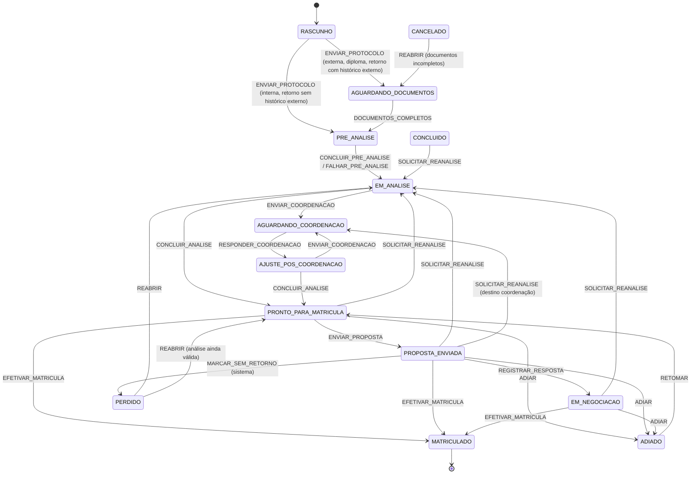

# 03 · Máquina de estados do caso

> O coração do sistema. **Uma etapa por vez, um dono por etapa, um prazo por etapa.** A máquina vive
> em código puro e testado (`src/features/casos/domain/caso.machine.ts`, ver
> `blueprints/caso.machine.ts`). O backend é a autoridade: o front usa a mesma tabela para desenhar a
> interface, mas a lista final de ações vem em `caso.acoesDisponiveis` da API.

## 1. Etapas

| Código | Rótulo na tela | Dono da etapa (papel) | SLA (parâmetro em `15-parametros.md`) | Tipo |
|---|---|---|---|---|
| `RASCUNHO` | Rascunho | Consultor | — | ativa |
| `AGUARDANDO_DOCUMENTOS` | Documentos | Candidato (acompanhamento: consultor) | `sla.documentos` | espera |
| `PRE_ANALISE` | Pré-análise | Sistema | `sla.preAnalise` | automática |
| `EM_ANALISE` | Em análise | Analista | `sla.analise` | ativa |
| `AGUARDANDO_COORDENACAO` | Coordenação | Coordenador do curso de destino | `sla.coordenacao` (24 h) | ativa |
| `AJUSTE_POS_COORDENACAO` | Ajuste | Analista (o mesmo do caso) | `sla.ajuste` | ativa |
| `PRONTO_PARA_MATRICULA` | Pronto p/ matrícula | Matrícula | `sla.primeiroContato` | ativa |
| `PROPOSTA_ENVIADA` | Proposta enviada | Candidato (acompanhamento: matrícula) | `regua.proposta` | espera |
| `EM_NEGOCIACAO` | Em conversa | Matrícula | `sla.respostaNegociacao` | ativa |
| `ADIADO` | Adiado | — (data de retomada) | até `retomarEm` | pausa |
| `MATRICULADO` | Matriculado | — | — | final |
| `PERDIDO` | Perdido | — | — | final (reabrível) |
| `CANCELADO` | Cancelado | — | — | final (reabrível) |

**Etapas ativas** são as que entram na fila. `RASCUNHO` só aparece para quem criou.

## 2. Diagrama

Transições de qualquer etapa ativa (omitidas no diagrama por legibilidade):

- `ENCERRAR_PERDIDO` → `PERDIDO` (motivo obrigatório)
- `CANCELAR` → `CANCELADO` (motivo obrigatório)
- `ALTERAR_DESTINO` (curso, turno, modalidade ou matriz) → `PRE_ANALISE` (zera as decisões, guarda a
  análise anterior no histórico; se o caso ainda está em documentos, continua lá)
- `ADIAR` a partir de `AGUARDANDO_DOCUMENTOS` → `ADIADO`, com `RETOMAR` voltando para
  `AGUARDANDO_DOCUMENTOS`. Regra geral: `RETOMAR` volta para `etapaAnterior`.

## 3. Tabela de transições (fonte de verdade para o código)

| Ação | De | Para | Quem pode | Guardas (todas precisam passar) | Efeitos colaterais |
|---|---|---|---|---|---|
| `ENVIAR_PROTOCOLO` | RASCUNHO | AGUARDANDO_DOCUMENTOS ou PRE_ANALISE | Consultor · Analista · Matrícula · Suporte · Admin | CPF válido · tipo · curso/turno/modalidade de destino · celular válido · sem caso ativo duplicado (mesmo CPF + mesmo curso) | Cria checklist do tipo; dispara template `protocolo_aberto`; em interna/retorno dispara migração do histórico |
| `DOCUMENTOS_COMPLETOS` | AGUARDANDO_DOCUMENTOS | PRE_ANALISE | Sistema (automático) · Analista (manual, com justificativa) | Todos os itens obrigatórios do checklist com status `ACEITO` | Dispara pré-análise; template `documentos_completos` |
| `CONCLUIR_PRE_ANALISE` | PRE_ANALISE | EM_ANALISE | Sistema | Resultado da IA recebido | Distribui para analista (`distribuicao.analise`) |
| `FALHAR_PRE_ANALISE` | PRE_ANALISE | EM_ANALISE | Sistema | Erro ou timeout da IA | Flag `preAnaliseFalhou`; distribui; analista pode `REEXECUTAR_PRE_ANALISE` |
| `ENVIAR_COORDENACAO` | EM_ANALISE · AJUSTE_POS_COORDENACAO | AGUARDANDO_COORDENACAO | Analista responsável | ≥ 1 item com pergunta aberta | Notifica coordenador (in-app + e-mail/Teams **[VALIDAR canal]**) com link direto |
| `RESPONDER_COORDENACAO` | AGUARDANDO_COORDENACAO | AJUSTE_POS_COORDENACAO | Coordenador do curso de destino | Todas as perguntas respondidas | Grava decisões; cria regras de equivalência marcadas; notifica analista |
| `CONCLUIR_ANALISE` | EM_ANALISE · AJUSTE_POS_COORDENACAO | PRONTO_PARA_MATRICULA | Analista responsável (ou Admin) | Todo item da matriz com decisão · nenhuma pergunta aberta · período de ingresso definido · horas complementares dentro dos limites · nenhuma origem repetida indevida | Congela "Resumo da análise" (versão); distribui para matrícula; cria tarefa de 1º contato |
| `ENVIAR_PROPOSTA` | PRONTO_PARA_MATRICULA | PROPOSTA_ENVIADA | Matrícula · Admin | Resumo congelado · condição financeira carregada · celular com opt-in **[VALIDAR regra de opt-in]** | Template `proposta_pronta` via Blip; inicia régua da proposta |
| `REGISTRAR_RESPOSTA` | PROPOSTA_ENVIADA | EM_NEGOCIACAO | Sistema (webhook Blip) · Matrícula (manual) | — | Notifica responsável; SLA de resposta começa |
| `EFETIVAR_MATRICULA` | PRONTO · PROPOSTA_ENVIADA · EM_NEGOCIACAO | MATRICULADO | Matrícula · Admin | Resumo congelado · aceite registrado (canal + data) | Chama ERP **[integração backend]**; template `matricula_confirmada`; pesquisa CSAT D+1 |
| `MARCAR_SEM_RETORNO` | PROPOSTA_ENVIADA | PERDIDO | Sistema | `regua.proposta.semRetornoDias` sem resposta | Motivo `SEM_RETORNO`; template `encerramento_porta_aberta` |
| `ENCERRAR_PERDIDO` | qualquer ativa | PERDIDO | Matrícula · Consultor · Analista | Motivo padronizado + texto opcional | Template opcional `encerramento_porta_aberta` |
| `CANCELAR` | qualquer ativa | CANCELADO | Analista · Admin · Consultor (só RASCUNHO e AGUARDANDO_DOCUMENTOS) | Motivo de cancelamento | Nenhuma mensagem ao candidato quando motivo = DUPLICADO ou TESTE |
| `ADIAR` | AGUARDANDO_DOCUMENTOS · PRONTO · PROPOSTA_ENVIADA · EM_NEGOCIACAO | ADIADO | Consultor (só em documentos) · Matrícula (demais) · Admin | `retomarEm` no futuro · motivo | Agenda retomada; pausa SLA |
| `RETOMAR` | ADIADO | `etapaAnterior` | Sistema (na data) · Matrícula · Consultor · Admin | — | Se a matriz do ciclo mudou e já havia resumo congelado, vai para PRE_ANALISE |
| `SOLICITAR_REANALISE` ("Reabrir análise") | PRONTO · PROPOSTA_ENVIADA · EM_NEGOCIACAO · CONCLUIDO | EM_ANALISE, ou AGUARDANDO_COORDENACAO com destino coordenação | Todos | Motivo, texto da contestação e, para a coordenação, ao menos uma disciplina contestada | `reanalises += 1`; resumo descongelado; disciplinas marcadas ganham `contestacao` e, para a coordenação, viram perguntas |
| `REABRIR` | PERDIDO · CANCELADO | PRONTO_PARA_MATRICULA (resumo do ciclo vigente) · senão EM_ANALISE (documentos completos ou tipo sem documentos externos) · senão AGUARDANDO_DOCUMENTOS | Analista · Matrícula · Diretoria · Admin | Motivo | — |
| `ALTERAR_DESTINO` | qualquer aberta exceto RASCUNHO | PRE_ANALISE (ou continua em AGUARDANDO_DOCUMENTOS se estava lá) | Analista · Matrícula · Admin · Consultor (só até PRE_ANALISE) | Motivo · novo curso/turno/modalidade/matriz definido | Arquiva análise anterior; reexecuta pré-análise; recalcula checklist |

Ações que **não** mudam a etapa: `ATRIBUIR`, `PEGAR_PROXIMO`, `ADICIONAR_NOTA`, `SOLICITAR_DOCUMENTO`,
`REEXECUTAR_PRE_ANALISE`, `PERGUNTAR_COORDENACAO` (por item), `MARCAR_OUVIDORIA`, `ESCALAR`,
`REGISTRAR_PENDENCIA_EXTERNA`, `RESOLVER_PENDENCIA_EXTERNA`, `ENVIAR_MENSAGEM`.

## 4. Motivos padronizados

**Perda (`ENCERRAR_PERDIDO`)** — lista fechada, mais "Outro" com texto obrigatório:
`FECHOU_OUTRA_IES` · `FINANCEIRO` · `APROVEITAMENTO_ABAIXO_DO_ESPERADO` · `PRAZO_DE_CONCLUSAO` ·
`HORARIO_TURNO` · `MODALIDADE` · `DESISTIU_DO_CURSO` · `MUDANCA_DE_CIDADE` · `SEM_RETORNO` ·
`DOCUMENTACAO_INCOMPLETA` · `NAO_ELEGIVEL` · `INSATISFACAO_ATENDIMENTO` · `OUTRO`.
(Alinhado à entrevista de saída da Frente 2: financeiro, acadêmico, pessoal, mudança de cidade,
insatisfação com curso, insatisfação com atendimento, concorrência.)

**Cancelamento:** `DUPLICADO` · `ABERTO_POR_ENGANO` · `TESTE` · `PEDIDO_DO_CANDIDATO_ANTES_DA_ANALISE`.
Casos `TESTE` são excluídos de todos os indicadores.

**Reanálise:** `CANDIDATO_CONTESTOU_DISCIPLINA` · `DOCUMENTO_NOVO` · `MUDANCA_CURSO_TURNO` ·
`ERRO_NA_ANALISE` · `DECISAO_COORDENACAO_REVISTA` · `OUTRO`.

**Adiamento:** `PROXIMO_CICLO` · `AGUARDANDO_RECURSO_FINANCEIRO` · `AGUARDANDO_DOCUMENTO_IES_ORIGEM` · `OUTRO`.

## 5. Pendência externa (pausa justificada de SLA)

Substitui situações como "Ag. edital DP" e "Pensando". Uma pendência externa **não muda a etapa**:
ela pausa o relógio do SLA com motivo e data de revisão e aparece na fila como "Pausado até 20/10".

| Tipo | Exemplo |
|---|---|
| `EDITAL_DP` | Aguardando publicação do edital de DP |
| `VAGA` | Aguardando confirmação de vaga no curso/turno |
| `DOCUMENTO_IES_ORIGEM` | IES de origem ainda não emitiu o histórico |
| `DECISAO_ACADEMICA` | Aguardando decisão de colegiado/diretoria acadêmica |

Regra: toda pendência tem `revisarEm`. No dia, o caso volta a contar SLA e o dono recebe aviso.
Pendência sem data não existe.

## 6. SLA

- O relógio começa quando o caso **entra** na etapa (`etapaDesde`).
- Cada etapa tem `duracao`, `calendario` (`UTEIS` ou `CORRIDAS`) e `alertaEm` (fração, padrão 0,8).
- Estados do relógio: `NO_PRAZO` (sem cor, "faltam 6 h") · `ATENCAO` (âmbar, "faltam 2 h") ·
  `ESTOURADO` (vermelho, "atrasado 5 h") · `PAUSADO` (cinza, "pausado até 20/10") · `SEM_SLA`.
- Horário útil e feriados vêm de `15-parametros.md` e, depois, de um calendário da API.
- Escalonamento da coordenação **[proposta, VALIDAR]**: alerta ao coordenador em 80% do prazo;
  estouro notifica coordenação geral/diretoria acadêmica; segundo estouro (48 h) marca o caso como
  `escalado`.

## 7. Distribuição

- **Análise:** ao sair de PRE_ANALISE, atribui ao analista com menor carga ativa entre os habilitados
  para o curso (parâmetro `distribuicao.analise = MENOR_CARGA | RODIZIO | MANUAL`). Sem analista
  disponível, fica "Sem responsável" no topo da fila e entra no "Pegar próximo".
- **Matrícula:** ao entrar em PRONTO_PARA_MATRICULA, atribui entre Mel, Maicon, Fabiola (configurável
  na API, nunca fixo no código) por `MENOR_CARGA`.
- **Coordenação:** o coordenador do curso de destino (vem da matriz/curso). Substituto configurável
  para férias.
- **"Pegar próximo":** abre o caso de maior prioridade sem responsável na etapa do papel e atribui a
  quem clicou. Prioridade = SLA estourado → ATENCAO → ouvidoria/escalado → mais antigo.

## 8. Concorrência

- Todo caso tem `versao` (inteiro). Mutations enviam `If-Match: <versao>`; a API responde `409` se
  mudou. O front mostra "Este caso foi atualizado por Fulano agora · Recarregar" e não sobrescreve.
- Presença: "Maicon está vendo este caso" (opcional, via evento `presenca`), para evitar duas
  pessoas ligando para o mesmo candidato.

## 9. Eventos de domínio (alimentam a linha do tempo e os indicadores)

`caso.criado` · `caso.atribuido` · `documento.solicitado` · `documento.recebido` ·
`documento.aceito` · `documento.recusado` · `documentos.completos` · `pre_analise.iniciada` ·
`pre_analise.concluida` · `pre_analise.falhou` · `analise.item_decidido` · `analise.itens_em_lote` ·
`coordenacao.pergunta_criada` · `coordenacao.enviada` · `coordenacao.item_respondido` ·
`coordenacao.concluida` · `equivalencia.criada` · `analise.concluida` · `proposta.enviada` ·
`mensagem.enviada` · `mensagem.recebida` · `proposta.respondida` · `matricula.efetivada` ·
`caso.adiado` · `caso.retomado` · `caso.reanalise_solicitada` · `caso.perdido` · `caso.cancelado` ·
`caso.reaberto` · `caso.destino_alterado` · `sla.alerta` · `sla.estourado` · `pendencia.registrada` ·
`pendencia.resolvida` · `nota.adicionada` · `caso.ouvidoria_marcada` · `caso.escalado`.

Cada evento: `{ id, casoId, tipo, em (ISO), autor: { tipo: PESSOA | SISTEMA | CANDIDATO | IA, id?, nome? }, dados }`.

## 10. Migração das situações antigas → etapas novas **[VALIDAR com a equipe]**

| Status/Situação antiga | Etapa nova | Observação |
|---|---|---|
| Novas análises | AGUARDANDO_DOCUMENTOS ou PRE_ANALISE | conforme tipo |
| Aguardando documentos | AGUARDANDO_DOCUMENTOS | |
| Em análise · "Realizando análise" | EM_ANALISE | |
| Reanálise - Realizando análise | EM_ANALISE | `reanalises ≥ 1` |
| Em análise coordenador · "Ag. anal. coordenação" | AGUARDANDO_COORDENACAO | |
| Entregue pelo coordenador | AJUSTE_POS_COORDENACAO | |
| "Ag. edital DP" | etapa atual + pendência `EDITAL_DP` | |
| Liberadas matrícula | PRONTO_PARA_MATRICULA | ver H4 do diagnóstico antes de migrar |
| "Pensando" | PROPOSTA_ENVIADA ou EM_NEGOCIACAO | depende de ter havido resposta |
| Concluídas | MATRICULADO ou PERDIDO | exige cruzamento com ERP |
| "Finalizar processo" / "Sem status" | revisar caso a caso | |

## Atualização operacional · 13/10/2026

Fases 0–8 concluídas na entrega inicial. Reformulação autorizada: tabela horizontal com protocolos separados, página inteira por análise, oito filas coloridas, acesso comum, busca por aluno e curso/oferta à vista. MAT é independente da etapa. As referências anteriores a papéis descrevem responsabilidades e não restringem ações humanas. docs/04, docs/05 e ADR-011 prevalecem sobre descrições de mestre-detalhe e limitações por papel. Preservar guardas, motivos, aceite e concorrência.
